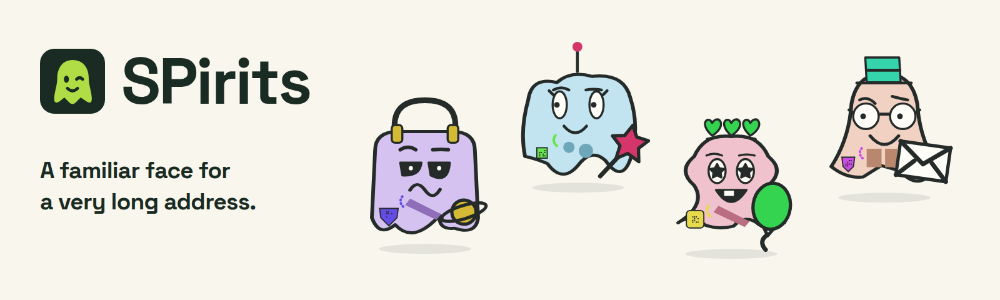

[](https://spirits.boo/)

<p align="center">
  <strong><a href="https://spirits.boo/">Meet your SPirit at spirits.boo</a></strong> · <a href="#use-in-your-app">Use in your app</a> · <a href="docs/README.md">Documentation</a>
</p>

# Give your address some spirit.

SPirits turns a Bitcoin Silent Payment address into a familiar little ghost. Create an avatar and a payment QR in your browser, or add both to your app.

## Meet your SPirit

1. Open [spirits.boo](https://spirits.boo/) and paste a Silent Payment address from your wallet, or choose **Try an example** to look around.
2. See your SPirit, or switch to **Payment QR** for a QR containing your full address with the matching ghost in the centre.
3. Download an SVG for scalable artwork or a PNG for sharing.

Everything is generated locally in your browser. Your address isn't uploaded.

## How it works

Your address's scan key shapes the ghost: its silhouette, expression, colours and signature accessory. Wallet labels that share that scan key keep the same character, with a small badge and trim variation. Changing the image size or export format keeps the character too.

## Use in your app

Render self-contained SVGs in Node 24 or a modern browser. The core includes the artwork and needs no network, DOM or canvas. The separate QR package adds the matching ghost to a standard payment QR.

```sh
npm install @remcoros/spirits@0.1.0 @remcoros/spirits-qr@0.1.0
```

```ts
import { createSpirit } from '@remcoros/spirits';
import { createSpiritQr } from '@remcoros/spirits-qr';

const address = 'sp1q…'; // Replace with your complete Silent Payment address.
const { svg } = createSpirit(address, { size: 512 });
const qr = createSpiritQr(address);
```

`svg` and `qr.svg` are SVG strings. Install only `@remcoros/spirits` if you do not need QRs.

SPirits is experimental, and the artwork may change between versions. Pin a package version if you need the same images over time.

The [integration guide](docs/usage.md) covers browser PNG export, standalone modules and links that open an address in the generator. See the [core API](packages/core/README.md) and [QR API](packages/qr/README.md) for more options.

## Run locally

Requires Node 24 and npm.

```sh
npm ci
npm run build:lib
npm run dev
```

Open [the generator](http://127.0.0.1:5187/) or [the lab](http://127.0.0.1:5187/lab/). The lab lets you inspect addresses, compare characters and explore label families.

Rebuild the libraries after changing their source. The dev site consumes their built exports; restarting Vite may also be needed after a rebuild.

Run `npm run check` for TypeScript and `npm test` for library contracts and final QR images. The [validation guide](docs/validation.md) covers browser checks, package consumers and visual audits.

## Explore further

- [Algorithm](docs/algorithm.md) and [artwork](docs/artwork.md): how addresses become characters, with [portable test vectors](spec/test-vectors.json).
- [Payment QRs](docs/qr.md): layout, sizing and wallet compatibility.
- [Architecture](docs/architecture.md): the libraries, generator and development lab.
- [Releasing](docs/releasing.md) and [hosting](docs/hosting.md): package publication and the website.

## Licences

Code is [MIT](LICENSE). Original artwork, including generated SPirits, is [CC0-1.0](ASSET-LICENSE). Dependencies retain their own licences; see [third-party notices](THIRD-PARTY.md).
